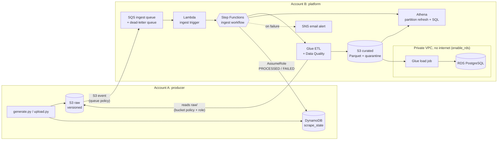

# AWS cross-account data pipeline

An event-driven data pipeline split across two AWS accounts. A **producer account** lands raw JSON files in S3; a **platform account** picks each file up, checks its quality, transforms it into partitioned Parquet, makes it queryable in Athena (and optionally loads it into a private PostgreSQL database), and writes the outcome back to the producer. Everything is deployed and torn down with Terraform.

> Personal learning project built with synthetic data only. Not production work.

- **Cross-account by design:** S3 event notifications into another account's queue, a bucket policy for a role in the other account, and `sts:AssumeRole` back the other way. No access keys are shared between accounts.
- **Data quality first:** Glue Data Quality checks every record; failures go to a quarantine with the rules they broke, and a file with too many bad rows is stopped before it reaches curated data.
- **Safe to rerun:** idempotent workflow names, partition overwrite, and `ON CONFLICT DO NOTHING` loads mean duplicates and retries do not duplicate data.
- **Reproducible:** both accounts were destroyed and rebuilt from Terraform, and an automated end-to-end test passed afterwards.

## Architecture



### How one file flows
1. `upload.py` puts a JSON file under `raw/` in Account A's bucket and writes a `RECEIVED` row to `scrape_state`.
2. S3 sends an event to the queue in Account B. The Lambda starts one Step Functions execution per file version (the name is a hash of bucket, key and version, so a duplicate event cannot start it twice).
3. **RunEtl:** Glue reads the file straight from Account A, runs the DQDL ruleset, quarantines failing and duplicate rows with their reasons, and writes valid rows as Parquet partitioned by `date` and `category`.
4. **RefreshPartitions:** Athena registers any new partitions.
5. **MarkProcessed:** the workflow assumes a role in Account A and sets the row to `PROCESSED` with the execution and Glue run IDs. Any failure instead sets `FAILED` and sends an email.

### Cross-account access (each needs both sides)
| What | Account A side | Account B side |
|---|---|---|
| A's bucket notifies B's queue | event notification on the bucket | queue policy: only `s3.amazonaws.com`, only for A's bucket and account |
| B's Glue reads A's raw files | bucket policy names B's Glue role, read-only on `raw/` | Glue role policy allows reading that bucket |
| B updates A's register | role `producer-state-writer`: trusts only B's workflow role; `GetItem`/`UpdateItem` on one table | workflow role may `sts:AssumeRole` that one role |

## Proof that it works
| Check | Result |
|---|---|
| End-to-end test (`tests/e2e/run_e2e.py`): upload in A, wait, verify | `PROCESSED` in A, workflow `SUCCEEDED`, Athena row count equals the prediction |
| Full rebuild (AC-08): `terraform destroy` both accounts, `terraform apply` both, rerun the test | passed |
| Data quality on a 5,000-record file with 244 planted defects | 4,758 valid, 242 quarantined with reasons; every count reconciled |
| Failure paths | a file with 42.5% bad rows and a corrupt file are both stopped, marked `FAILED`, and emailed |
| Idempotent database load | loading the same data twice inserts 0 new rows |
| Secret scan (trivy, canary-tested) | 0 findings in files and Git history |
| Terraform scan (checkov) | 263 checks passed; 6 findings fixed; 29 accepted with the reason written next to the resource |
| IAM Access Analyzer | only the two intended cross-account grants (archived by rule); nothing in Account B reachable from outside |

## Cost
Measured while building, region `ap-south-1`:

| Item | Cost |
|---|---|
| Idle (nothing running) | a few cents per month: S3 storage, an on-demand DynamoDB table, the Terraform state bucket |
| Processing one file | about $0.02: one small Glue Flex run (2 workers, about 2 minutes); Lambda, SQS, Step Functions and Athena are fractions of a cent |
| RDS session (`enable_rds = true`) | db.t4g.micro on the free tier, plus about $0.035 per hour for three VPC interface endpoints; switched off after each session |
| Whole build so far | a few dollars at most |

Cost controls: budgets in both accounts, Glue Flex with 2 workers and a 10-minute timeout, a 1 GB per-query limit in Athena, no NAT gateway, lifecycle rules on every bucket, 14-day log retention, and RDS only while it is needed.

## Deploy, run, tear down
Prerequisites: Terraform 1.10+, Python 3.12 with `boto3`, AWS CLI profiles `default` (Account A) and `acct-b` (Account B).

1. **State bucket (once):** in `terraform/bootstrap`, run `terraform init` and `terraform apply`.
2. **Settings:** in `terraform/account-b` and `terraform/account-a`, copy `backend.hcl.example` to `backend.hcl` and `terraform.tfvars.example` to `terraform.tfvars`, fill them in, then run `terraform init "-backend-config=backend.hcl"`.
3. **Apply Account B first**, confirm the SNS email, **then Account A**. A's bucket policy names B's Glue role, which must already exist.
4. **Test:** `python tests/e2e/run_e2e.py` (three checks PASS).
5. **Generate more data:** `python src/generator/generate.py`, then `python src/generator/upload.py` (each file is processed automatically).
6. **Optional RDS session:** `terraform apply -var "enable_rds=true"` in `terraform/account-b`, run the `platform-load-rds` Glue job, then apply again without the variable.
7. **Tear down:** in `terraform/account-a`, set `allow_destroy_raw = true`, apply, then `terraform destroy`; then `terraform destroy` in `terraform/account-b`.

## Repo layout
```
terraform/bootstrap/          state bucket for the other two roots (applied once, local state)
terraform/account-b/          platform: S3, SQS, Lambda, Glue, catalog, Athena, Step Functions, alerts, VPC, RDS switch
terraform/account-a/          producer: raw bucket + policy + event, scrape_state, producer-state-writer, Access Analyzer
src/generator/                generate.py (synthetic data with planted defects), upload.py (S3 + DynamoDB)
src/lambda/ingest_trigger/    handler.py (starts the workflow), test_event.json
src/glue/                     etl_products.py (ETL + Glue Data Quality), load_rds.py (RDS load)
src/stepfunctions/            ingest_workflow.asl.json (read by Terraform)
tests/e2e/run_e2e.py          end-to-end test
docs/                         requirements, architecture, ADRs, decisions, tests, security, interview notes
local/accounts.env.example    template for local/accounts.env (real IDs, not committed)
```

No account ID is committed. Terraform reads its own account from AWS and takes the other account's ID from `terraform.tfvars`; the state bucket name is in `backend.hcl`; local scripts read `local/accounts.env`. All three are ignored by Git, and each has a committed `.example`.

## Built with
AWS (S3, SQS, Lambda, Step Functions, Glue ETL and Data Quality, Glue Data Catalog, Athena, DynamoDB, RDS PostgreSQL, VPC endpoints, SNS, CloudWatch, IAM Access Analyzer), Terraform, Python, PySpark.

## Next steps
- CI/CD with GitHub Actions and OIDC (no stored keys) running `plan`, the scans and the e2e test
- X-Ray tracing and VPC flow logs
- A scale test with about 22 million records
- Real data from public APIs (Open Prices, eBay Browse API)

## Documentation
Start with [How to use these docs](docs/HOW_TO_USE_THESE_DOCS.md).

| Area | Documents |
|---|---|
| Product | [Brief](docs/01-product/PROJECT_BRIEF.md), [Requirements](docs/01-product/REQUIREMENTS.md), [User stories](docs/01-product/USER_STORIES.md), [Acceptance criteria](docs/01-product/ACCEPTANCE_CRITERIA.md) |
| Architecture | [Architecture](docs/02-architecture/ARCHITECTURE.md), [Data flow](docs/02-architecture/DATA_FLOW.md), [Data model](docs/02-architecture/DATA_MODEL.md), [Tech stack](docs/02-architecture/TECH_STACK.md), [Resource inventory](docs/02-architecture/RESOURCE_INVENTORY.md) |
| Decisions | [ADR-001 account split](docs/adr/ADR-001-two-account-producer-platform-split.md), [ADR-002 direct cross-account read](docs/adr/ADR-002-glue-reads-producer-bucket-directly.md), [ADR-005 Terraform layout and cut-over](docs/adr/ADR-005-terraform-layout-and-cutover.md), [Decisions log](docs/05-learning/DECISIONS_AND_TRADEOFFS.md) |
| Quality and operations | [Test strategy](docs/03-quality-ops/TEST_STRATEGY.md), [Data quality](docs/03-quality-ops/DATA_QUALITY.md), [Observability](docs/03-quality-ops/OBSERVABILITY.md), [Security](docs/03-quality-ops/SECURITY.md), [SLO](docs/03-quality-ops/SLO.md) |
| Delivery | [Implementation plan](docs/04-delivery/IMPLEMENTATION_PLAN.md), [Tasks](docs/04-delivery/TASKS.md), [Definition of done](docs/04-delivery/DEFINITION_OF_DONE.md), [Risks](docs/04-delivery/RISKS.md) |
| Learning | [Learning plan](docs/05-learning/LEARNING_PLAN.md), [Interview notes](docs/05-learning/INTERVIEW_NOTES.md) |
